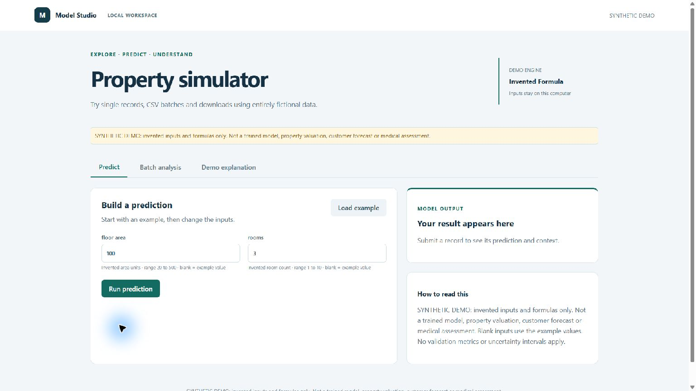
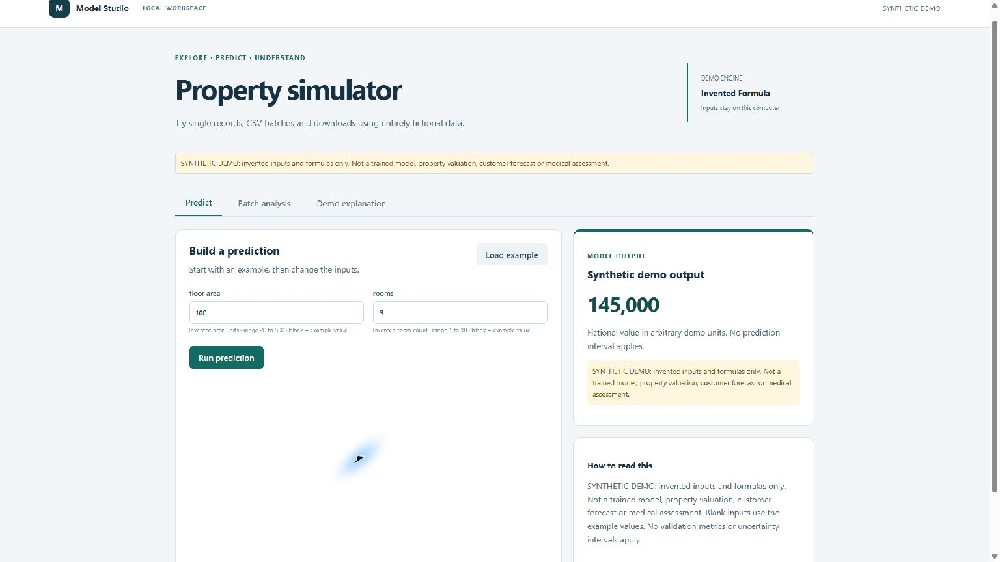
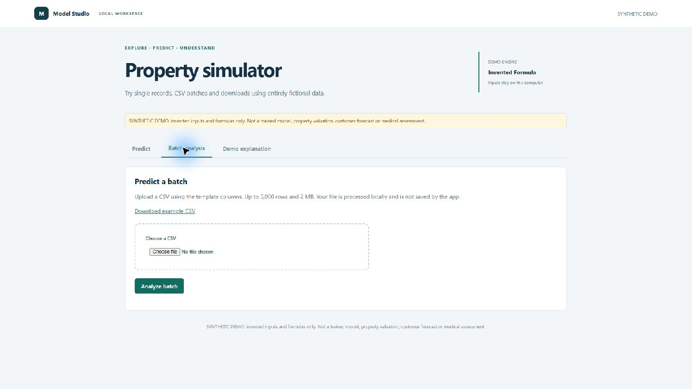

# Illustrated synthetic-demo walkthrough

Start with [DEMO.md](../DEMO.md). These screenshots show the actual local app
using fictional inputs and formulas, not real-world model predictions.

## 1. Enter a record

Confirm **SYNTHETIC DEMO** is visible. Load the supplied example and optionally
change values within the displayed ranges.

## 2. Run the example

Click **Run prediction**. The default example returns **145,000 fictional units**.
Values use arbitrary units and have no prediction interval.

## 3. Process a batch

Open **Batch analysis**, download the example CSV, choose that file and click
**Analyze batch**. The template has three invented rows. Download the results
and check that each row includes `mode=synthetic_demo`.
The screenshot shows the batch interface before file selection.

## 4. Explain what is real

Open **Demo explanation** for the formula. The separate trained study is described
in [README.md](../README.md), including its historical results and limitations.

## 60-second recording script

| Time | Show | Explain |
|---|---|---|
| 0-10 s | Title and synthetic label | Introduce the project and explicitly identify the fictional demo. |
| 10-25 s | Inputs and result | Show validation and how a record moves through the local API. |
| 25-40 s | CSV workflow | Explain the template, batch limit and marked downloads. |
| 40-50 s | Demo explanation | Show the formula; distinguish it from the trained pipeline. |
| 50-60 s | README results | Describe the actual study, evaluation limits and reproducibility. |

Keep the synthetic label visible when recording. Watch the [captioned screenshot video](videos/synthetic-demo.mp4) or read its
[transcript](videos/TRANSCRIPT.md). The video is assembled from captured screens;
it is not a live interaction recording.
